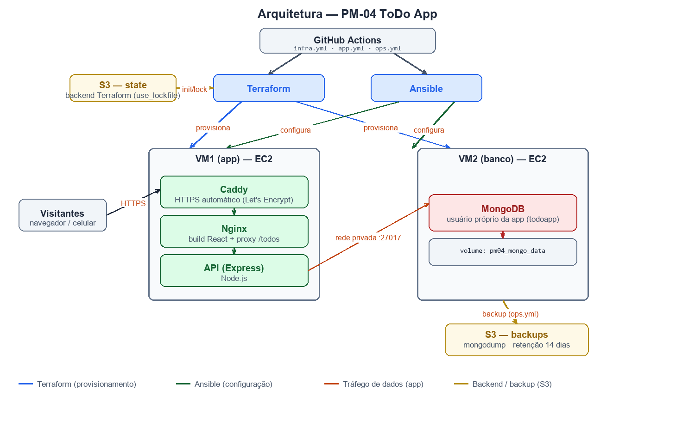
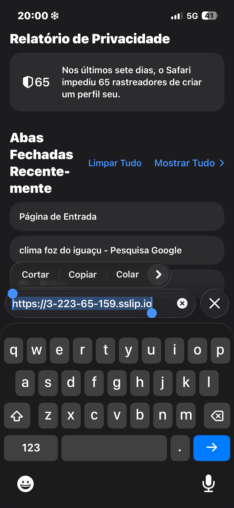
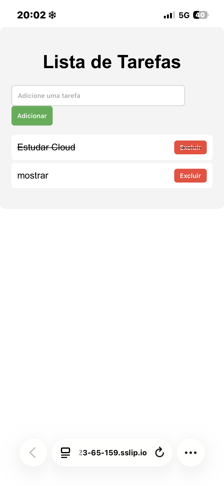
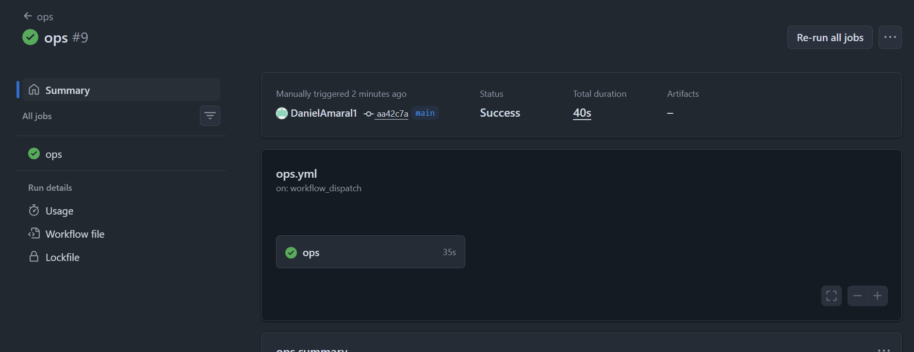
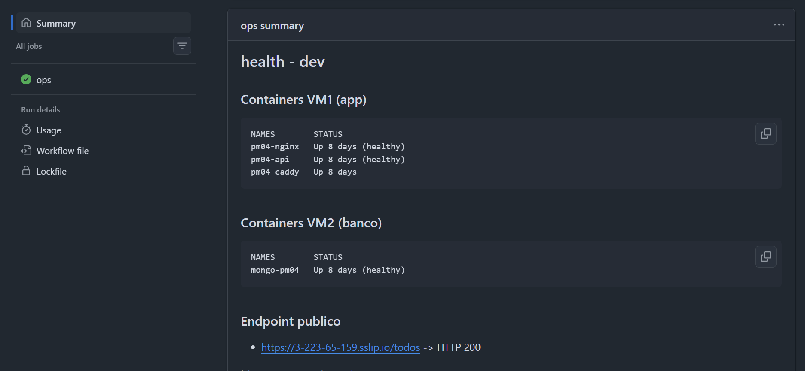

# PM-04 · Projeto Final

## Automação de infraestrutura com Terraform, Ansible e CI/CD

**Disciplina:** DevOps e Infraestrutura
**Integrantes:** Daniel Spies Amaral · Luiz Guilherme Moura Pias
**Data de entrega:** 27/11/2026


## Link do repositório

https://github.com/DanielAmaral1/pm04 (público)

**URL pública da aplicação entregue:** https://3-223-65-159.sslip.io


## 1. Análise da demanda

O documento de demanda ([`todo-app`](https://github.com/LaercioMLB/todo-app),
`docs/escopo.md`) pede a implantação em nuvem do ToDo App para a Feira de
Profissões: aplicação e banco em VMs distintas, acesso público só pela
aplicação, e toda a infraestrutura/operação automatizada por pipelines.

| Requisito do escopo | Recurso entregue |
| --- | --- |
| **REQ-01 · Servidores** — no mínimo duas VMs, uma dedicada ao MongoDB; justificar recursos adicionais | `terraform/ec2.tf`: `aws_instance.app` (VM1) e `aws_instance.db` (VM2), MongoDB exclusivo na VM2. Recursos adicionais: bucket S3 de state (`terraform/backend.tf`) e bucket S3 de backups com lifecycle de 14 dias (`terraform/backups.tf`) — ambos necessários para o backend do Terraform e para o REQ-04 de persistência/recuperação. |
| **REQ-02 · Rede privada** — MongoDB acessível só pela API, nunca publicado na internet | `terraform/security_groups.tf`: `sg_db` libera a porta 27017 **somente** a partir do `sg_app` (referência de security group, não CIDR/IP). Nenhuma regra de entrada pública na VM2. Testado tentando conectar na porta 27017 pelo IP público da VM2 de fora da rede — bloqueado (ver seção 5, ACE-03). |
| **REQ-03 · Acessos** — administração restrita, credencial própria da aplicação no banco, segredos fora do código/logs | SSH da VM1 liberado só durante a execução da pipeline (via AWS CLI, fora do state do Terraform, revogado com `if: always()`); VM2 só acessível via `ProxyJump` pela VM1, nunca diretamente. MongoDB usa um usuário próprio da aplicação (`todoapp`, `readWrite` só no banco `todo-app`), separado do `root` administrativo. Todas as credenciais (AWS, SSH, Mongo) ficam só em GitHub Secrets; tasks do Ansible que as manipulam usam `no_log: true`. |
| **REQ-04 · Persistência** — armazenamento persistente, backup e restauração testada, atualizações não podem apagar tarefas | Volume Docker nomeado `pm04_mongo_data` (não efêmero). Testado removendo o container do Mongo e recriando via `infra.yml` — os mesmos documentos continuaram no lugar (seção 5, ACE-05). `ops.yml` com operação `backup` (`mongodump` → S3) e `restore` (restauração conferida em container isolado, sem tocar no banco principal). |
| **REQ-05 · Publicação** — URL HTTPS utilizável em outro dispositivo, frontend e API no mesmo endereço público | Caddy obtém certificado HTTPS automático (Let's Encrypt) para o domínio `<ip-com-hifens>.sslip.io`; Nginx serve o build do React e repassa `/todos` e `/todos/:id` para a API, preservando métodos — frontend e API no mesmo domínio público. |
| **REQ-06 · Disponibilidade** — reinício de serviços, verificações de saúde (incluindo conexão da API ao banco), diagnóstico documentado | Todos os containers com `restart: unless-stopped`; API, Nginx e Mongo com healthcheck próprio (Caddy não tem healthcheck definido). A rota `GET /health` da API verifica a conexão com o Mongo. `ops.yml` com operações `health`, `logs` e `restart`. Falhas comuns e diagnóstico documentados em `docs/manual-alunos.md`. |


## 2. Decisões de arquitetura



| Decisão | Justificativa |
| --- | --- |
| AWS, `us-east-1`, sem NAT Gateway | Provedor com créditos de conta de testes já disponíveis. NAT Gateway custa ~US$ 32/mês só de taxa fixa — desproporcional ao uso pontual da feira; a VM2 usa IP público só para saída (`apt`/`docker`), sem porta de entrada liberada (justificativa completa em `docs/custos.md`). |
| VM1 com Elastic IP, VM2 com IP dinâmico | O domínio `sslip.io` (e o certificado HTTPS) depende de um IP público estável para a VM1; a VM2 não precisa de IP estável porque nunca é acessada de fora, só serve de saída. |
| Caddy na frente do Nginx | Automatiza completamente a emissão/renovação do certificado Let's Encrypt (REQ-05) sem precisar comprar domínio nem configurar DNS manual — usa `sslip.io`, que resolve `<ip>.sslip.io` para o próprio IP. |
| Build das imagens no runner do GitHub, não nas VMs | `t3.micro`/`t3.small` (1–2GB de RAM) não têm recursos para buildar um frontend React; as VMs só fazem `docker pull` das imagens já publicadas no GHCR pelo `app.yml`. |
| Backend do Terraform em S3 com `use_lockfile` | Lock nativo do S3 (recurso novo do Terraform 1.10+), evita precisar provisionar e manter uma tabela DynamoDB só para lock. |
| SSH da VM1 liberado fora do Terraform (AWS CLI) | Se a regra de SSH temporária estivesse no state do Terraform, toda reexecução (inclusive o cenário 3, idempotente) mostraria uma mudança de drift nela — abrir/fechar via AWS CLI, fora do state, resolve isso. |
| MongoDB com cache limitado e swap nas VMs | `--wiredTigerCacheSizeGB 0.25` e 1,5GB de swap nas duas VMs, porque uma `t3.micro` só tem 1GB de RAM — sem isso o Mongo (ou o conjunto dos containers) não caberia. |
| Usuário da app separado do root no Mongo | Mitiga o impacto de uma eventual falha/vazamento na API — a credencial exposta nunca tem privilégio administrativo sobre o banco. |
| Retenção de backup curta (14 dias) | O uso é pontual (preparação + feira); reter backups por mais tempo só aumentaria custo de armazenamento sem necessidade real. |

Mais detalhes de dimensionamento e custo em [`custos.md`](custos.md) (ver
resumo na seção 6 desta entrega).


## 3. Pipelines e parâmetros

| Pipeline | Função |
| --- | --- |
| `infra.yml` | `terraform fmt/validate/init/plan/apply` (ou `destroy`) + Ansible completo (`base_packages → os_updates → docker → mongodb → app → healthcheck`) nas duas VMs. |
| `app.yml` | Valida, builda e publica as imagens no GHCR (tag = SHA curto do commit); implanta na VM1; rollback via `action=deploy_only` com uma tag anterior. |
| `ops.yml` | `health`, `restart`, `logs`, `backup`, `restore` (em container isolado) e `reset_demo` (exige `confirm_reset=RESET`). |

### Parâmetros do `infra.yml`

| Parâmetro | Exemplo | Efeito |
| --- | --- | --- |
| `environment` | `dev` | Prefixo do state (`pm04/<environment>/terraform.tfstate`) e das tags. |
| `action` | `plan` / `apply` / `destroy` | Operação do Terraform. |
| `instance_name` / `instance_type` | `pm04-app` / `t3.micro` | Nome e tipo **da VM1** (app). |
| `db_instance_name` / `db_instance_type` | `pm04-db` / `t3.micro` | Nome e tipo **da VM2** (banco) — variável própria. |
| `docker_image` | `ghcr.io/danielamaral1/pm04` | Base das imagens; vira `<docker_image>-backend:<docker_tag>` e `<docker_image>-frontend:<docker_tag>`. |
| `docker_tag` | SHA curto gerado pelo `app.yml` | Versão das imagens a implantar na VM1. |
| `update_os` | `true` / `false` | Roda `apt upgrade` nas duas VMs. |
| `extra_packages` | `curl,git,unzip` | Pacotes adicionais instalados nas duas VMs. |

Todos os cinco parâmetros recomendados pelo PM-04
(`instance_name`, `instance_type`, `docker_image`, `docker_tag`,
`update_os`) estão implementados, mais `extra_packages` e as variáveis
próprias da VM2 (`db_instance_name`/`db_instance_type`), exigidas pelo
desenho de duas VMs deste projeto.


## 4. Testes dos cenários obrigatórios

### Cenário 1 — Criação inicial

**Run:** https://github.com/DanielAmaral1/pm04/actions/runs/44208709706

A partir do zero (nenhum recurso existente), `infra.yml action=apply` roda
`terraform init/plan/apply` — criando VPC, subnet, security groups, as
duas VMs e o Elastic IP — e em seguida o Ansible completo nas duas VMs,
terminando com o healthcheck HTTPS passando.

- `https://3-223-65-159.sslip.io/todos` responde 200, certificado Let's
  Encrypt válido (confirmado nesta entrega: `issuer=Let's Encrypt`,
  `notBefore=17 Nov 2026`).
- Porta 27017 do IP público da VM2 bloqueada para conexão externa (teste:
  `timeout 5 bash -c "echo > /dev/tcp/<ip-publico-vm2>/27017"` → sem
  resposta).

### Cenário 2 — Atualização do ambiente

**Run:** https://github.com/DanielAmaral1/pm04/actions/runs/44422755271

Parâmetros alterados: `instance_type` da VM1 (`t3.micro` → `t3.small`),
`extra_packages` (vazio → `htop,tree`), `update_os` (`false` → `true`).

Trecho do `terraform plan`:
```
# aws_instance.app will be updated in-place
  ~ instance_type = "t3.micro" -> "t3.small"
Plan: 0 to add, 1 to change, 0 to destroy.
```
Trecho do PLAY RECAP do Ansible:
```
<IP VM2> : ok=18  changed=2  unreachable=0  failed=0  skipped=11
<IP VM1> : ok=20  changed=3  unreachable=0  failed=0  skipped=10
```
Prova: Terraform atualizou a VM1 **sem recriar** (IP público e domínio
continuaram `3.223.65.159` / `3-223-65-159.sslip.io`), e o Ansible mostra
mudança real (`changed>0`) nas duas VMs.

### Cenário 3 — Reexecução sem alterações

**Run:** https://github.com/DanielAmaral1/pm04/actions/runs/44425051980

Mesmos parâmetros do cenário 2, executados de novo.

```
No changes. Your infrastructure matches the configuration.
```
```
<IP VM2> : ok=18  changed=0  unreachable=0  failed=0  skipped=11
<IP VM1> : ok=20  changed=0  unreachable=0  failed=0  skipped=10
```
Prova: nenhuma alteração desnecessária no Terraform, Ansible idempotente
nas duas VMs (`changed=0`).

> Uma primeira tentativa de reexecução ([run 44423436082](https://github.com/DanielAmaral1/pm04/actions/runs/44423436082))
> mostrou `changed=1` na VM1 por um bug real do módulo
> `community.docker.docker_login` — ver seção 7, item 11.

### Operações (`ops.yml`)

| Operação | Run | Resultado |
| --- | --- | --- |
| `health` | [44428538759](https://github.com/DanielAmaral1/pm04/actions/runs/44428538759) | Containers das duas VMs "Up", endpoint público HTTP 200. |
| `backup` | [44428718519](https://github.com/DanielAmaral1/pm04/actions/runs/44428718519) | `mongodump` enviado para `s3://pm04-mongo-backups-dev-.../dev/pm04-backup-20261119T002444Z.gz`. |
| `restore` | [44428845526](https://github.com/DanielAmaral1/pm04/actions/runs/44428845526) | 4 documentos restaurados num container **isolado**, destruído ao final; banco principal não tocado. |
| `logs` | [44429097180](https://github.com/DanielAmaral1/pm04/actions/runs/44429097180) | Últimas 100 linhas de cada container no job summary. |
| `restart` | [44429400601](https://github.com/DanielAmaral1/pm04/actions/runs/44429400601) | Containers das duas VMs `Restarting` → `Started`. |
| `reset_demo` sem confirmação | [44429543674](https://github.com/DanielAmaral1/pm04/actions/runs/44429543674) | Bloqueado de propósito (`confirm_reset` precisa ser `RESET`). |
| `reset_demo` confirmado | [44439096440](https://github.com/DanielAmaral1/pm04/actions/runs/44439096440) | Lista apagada e reseedada com os 3 itens padrão. |

Lista completa de runs, incluindo os testes extras de ACE-05 (recriação de
container preservando dados) e ACE-06 (rollback de versão), em
[`evidencias/README.md`](../evidencias/README.md).


## 5. Validação da demanda — ACE-01 a ACE-10

| Critério | Como foi demonstrado |
| --- | --- |
| **ACE-01 · Reprodução** | Ambiente criado do zero só com código + pipelines (cenário 1 acima); pré-requisitos e parâmetros documentados no README. |
| **ACE-02 · Duas VMs** | `aws_instance.app` e `aws_instance.db` distintas; MongoDB só na VM2 (`terraform/ec2.tf`). |
| **ACE-03 · Isolamento** | Porta 27017 da VM2 bloqueada externamente; API conecta pelo IP privado (ver cenário 1). |
| **ACE-04 · Aplicação pública** | **Demonstrado.** Acesso pelo celular (rede 5G, fora da infraestrutura) comprovado nos prints da seção "Evidências visuais" — URL pública aberta no Safari e a aplicação funcionando. Complementado por um ciclo completo de CRUD via `curl` (cadastro, conclusão, reabertura, exclusão e confirmação do estado a cada passo — reprodução literal abaixo) e pelo certificado HTTPS confirmado via `openssl s_client`. |
| **ACE-05 · Persistência** | Container do Mongo removido manualmente e recriado via `infra.yml` — os mesmos `_id` de documento continuaram presentes. `restart` (ops.yml) e atualização da aplicação (`app.yml`) testados sem perda de dados. |
| **ACE-06 · Automação** | `infra.yml`/`app.yml` com tag identificada (SHA curto); rollback testado de verdade: deploy de uma tag anterior funcionando, depois redeploy da tag atual. |
| **ACE-07 · Recuperação** | Backup real em S3 + restauração conferida em container isolado (ver tabela de operações). |
| **ACE-08 · Operação** | `health`/`logs`/`restart` funcionais; credenciais nunca em código ou logs (`no_log: true`). |
| **ACE-09 · Custos** | Seção 6 desta entrega / `docs/custos.md`. |
| **ACE-10 · Transferência** | **Demonstrado.** A rotina `health` foi executada pela equipe (Luiz) seguindo só o `docs/manual-alunos.md`, sem apoio de quem escreveu a pipeline — prints na seção "Evidências visuais", run [46079062557](https://github.com/DanielAmaral1/pm04/actions/runs/46079062557). A demonstração completa do fluxo (iniciar, verificar, atualizar, logs, recuperar, preparar a demo, encerrar) pelos dois integrantes ocorre na apresentação do projeto. |

### Evidência de CRUD (ACE-04) — registrada no momento desta entrega

```
GET /todos (estado inicial)
[Bem-vindo ao ToDo App..., Dados de demonstracao..., Estudar Cloud (concluida)]

POST /todos {"text":"Entrega PM-04 - evidencia de CRUD via curl"}
-> 201 Created, _id=6b0a008cf8edd8e657443306, completed=false

PATCH /todos/6b0a008cf8edd8e657443306  (concluir)
-> completed=true

PATCH /todos/6b0a008cf8edd8e657443306  (reabrir)
-> completed=false

GET /todos (apos "reload")
-> lista contem a tarefa criada, com o estado correto

DELETE /todos/6b0a008cf8edd8e657443306
-> {"message":"Tarefa excluída com sucesso"}

GET /todos (estado final)
-> tarefa de teste nao aparece mais; os 3 itens de demonstracao continuam

Certificado HTTPS: subject=CN=3-223-65-159.sslip.io
                    issuer=Let's Encrypt
                    validade: 17 Nov 2026 - 15 Fev 2027
```

### Evidências visuais

**ACE-04 — acesso pelo celular (rede 5G), fora da infraestrutura:**





**ACE-10 — rotina `health` executada pela equipe seguindo o manual:**





## 6. Custos

Resumo (ver [`docs/custos.md`](custos.md) completo, com fontes de preço):

| | |
| --- | --- |
| Custo mensal de referência (ambiente ligado 24/7) | ≈ US$ 25,75 |
| Custo estimado do período da feira (premissa: ~28h de uso real) | ≈ US$ 1,23 |
| Créditos disponíveis (conta de testes) | ~US$ 74 (separado do custo recorrente) |
| Continua cobrando após `destroy` | Bucket de state e bucket de backups (S3) — storage residual, poucos centavos/mês; precisam ser removidos manualmente se quiser custo zero. |

Maior item de custo recorrente: os dois endereços IPv4 públicos
(cobrados US$ 0,005/hora **cada** desde fev/2024, incluindo o Elastic IP),
não as instâncias EC2 em si.


## 7. Problemas encontrados e soluções

Bugs reais descobertos rodando a pipeline de ponta a ponta contra a AWS
(lista completa, com mais detalhe técnico, no `README.md` do repositório):

1. **IAM sem permissão nenhuma** — usuário da pipeline só tinha
   `IAMUserChangePassword`; corrigido concedendo EC2 e S3 escopados.
2. **Caminho duplicado no job summary** — `terraform/terraform/plan.txt`
   por não considerar o `working-directory` do job.
3. **Falha de SSH mascarada** — um `for` sem checagem final reportava
   sucesso mesmo quando toda tentativa de SSH falhava.
4. **Chave SSH incompatível** — os secrets não formavam um par válido;
   como a chave é gravada no boot da instância, foi preciso recriar as
   VMs (`terraform apply -replace`), não só atualizar os secrets.
5. **`| tee` mascarando falha do Ansible** — o shell padrão das actions
   não tem `pipefail`; corrigido com `set -o pipefail`.
6. **Falta de espera pela VM2** — só havia espera de SSH para a VM1; a
   play da VM2 tentava `ProxyJump` cedo demais e abortava o playbook
   inteiro antes de chegar na VM1.
7. **`arch=False` no repositório do Docker** — precedência do operador
   `|` do Jinja2 (`==` avaliado depois do filtro) gerava um valor sempre
   falso, quebrando o índice de pacotes (`docker-ce` não encontrado).
8. **Healthcheck com `localhost` caindo em IPv6** — `wget`/`node`
   resolviam `::1` antes de `127.0.0.1`; os servidores só escutavam IPv4.
9. **Checagem local batendo no Caddy, não no Nginx** — só o Caddy publica
   a porta 80 no host; a checagem "antes do TLS" na prática virava uma
   chamada HTTPS prematura, antes do certificado ficar pronto.
10. **Init automático do Mongo nunca rodava** — o mecanismo
    `/docker-entrypoint-initdb.d` imprimia "ignoring" e nunca criava o
    usuário da aplicação; substituído por tasks Ansible explícitas e
    idempotentes.
11. **`docker_login` não é idempotente** — sempre reporta `changed=true`,
    mas o token do GHCR é efêmero (não dá pra simplesmente pular o
    login); corrigido com `changed_when: false` (renovar o token não é
    drift de configuração).
12. **`ops.yml restart` com "Permission denied"** — `cd` num diretório
    `0750` (root) falhava para o usuário `ubuntu`; corrigido com
    `sudo docker compose -f <caminho>`.


## Anexo

Documentos completos citados nesta entrega, todos versionados no
repositório:

- [`README.md`](../README.md) — arquitetura completa, parâmetros, lista
  de problemas e soluções, "como reproduzir do zero".
- [`evidencias/README.md`](../evidencias/README.md) — links de execução
  de todos os cenários e operações.
- [`evidencias/aceite.md`](../evidencias/aceite.md) — tabela ACE-01..10.
- [`docs/custos.md`](custos.md) — estimativa de custos completa.
- [`docs/manual-alunos.md`](manual-alunos.md) — manual de operação.
